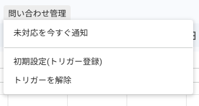
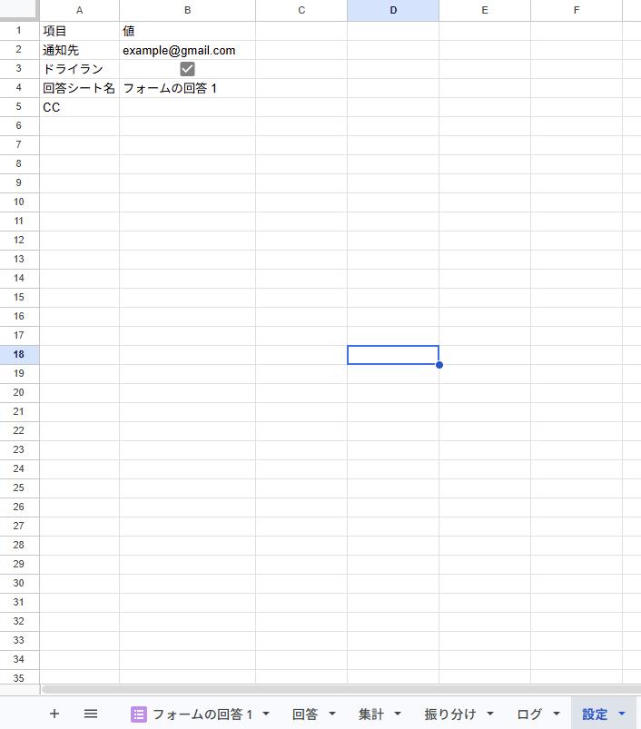
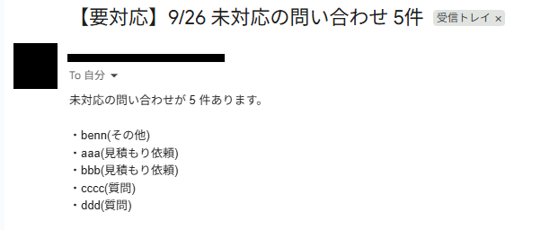
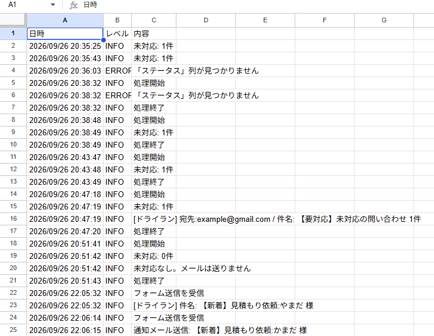

# InquiryNotifier(問い合わせ管理・自動通知ツール)

Google フォームに届いた問い合わせをスプレッドシートで管理し、担当者へ自動でメール通知する Google Apps Script(GAS)ツールです。

- フォームに回答が来たら、ステータスに「未対応」を記入して担当者へ新着通知
- 毎朝、未対応の問い合わせをまとめて通知(対応漏れ防止)
- 問い合わせた人へ、受付完了の自動返信メール(文面はシートで編集)
- 宛先・CC・ドライランなどの設定は「設定」シートで変更でき、コードを触る必要はありません
- 初期設定はメニューのボタン1つ。トリガー画面の操作は不要です

## 主な機能

| 機能 | 内容 |
|---|---|
| 新着通知 | フォーム送信時に、回答行のステータスへ「未対応」を記入し、通知メールを送信 |
| 未対応まとめ通知 | 毎朝 9 時台に、ステータスが「未対応」の問い合わせを一覧にしてメール送信(0 件なら送らない) |
| 種別ごとの振り分け | 「振り分け」シートで、問い合わせの種別ごとに通知先を指定(未登録の種別は既定の通知先へ) |
| 自動返信 | 回答者へ受付完了メールを自動送信。件名・本文は「自動返信」シートで編集でき、`{{氏名}}` などで回答内容を差し込み可能 |
| 複数宛先・CC | 通知先・CC にカンマ区切りで複数のアドレスを指定可能 |
| ドライラン | チェックボックス 1 つで、メールを送らずにログだけ残すテスト実行に切り替え |
| ログ | 「ログ」シートに実行日時・結果・エラー内容を記録 |
| 独自メニュー | スプレッドシートに「問い合わせ管理」メニューを追加(今すぐ通知/初期設定/トリガー解除) |
| 初期設定ボタン | 設定シート・振り分けシートの作成とトリガー登録を一括で実行(何度押しても二重登録しない) |
| エラーの見える化 | 設定漏れ・シート名違い・フォームの質問名違いを、分かりやすいメッセージでログに記録 |

## スクリーンショット

| メニュー | 設定シート |
|---|---|
|  |  |

| 通知メール | ログシート |
|---|---|
|  |  |

## 動作環境

- Google アカウント(無料アカウントで動作確認済み)
- Google スプレッドシート + Google フォーム
- ソフトのインストールは不要です(ブラウザだけで動作します)

## ファイル構成

```
InquiryNotifier/
├─ src/
│  ├─ main.js     … メイン処理(未対応まとめ通知・フォーム送信時の新着通知)
│  ├─ config.js   … 設定シート・振り分けシートの読み込み
│  ├─ sheet.js    … 見出し行の取得・未対応行の抽出
│  ├─ mail.js     … メール本文の作成・送信(ドライラン対応)
│  ├─ reply.js    … 回答者への自動返信
│  ├─ log.js      … ログシートへの記録
│  ├─ menu.js     … 独自メニュー
│  └─ setup.js    … 初期設定・トリガー解除
├─ docs/          … スクリーンショット
├─ LICENSE
└─ README.md
```

Apps Script エディタでは `.gs` ファイルとして作成します(中身は同じです)。

## 導入手順

### 1. フォームとスプレッドシートを用意する

1. 新しいスプレッドシートを作成し、メニューの「挿入 → フォーム」でフォームを作成します。
2. フォームに次の質問を作成します。**質問のタイトルは表のとおりに入力してください。**

   | 質問のタイトル | 形式の例 |
   |---|---|
   | 氏名 | 記述式 |
   | メール | 記述式 |
   | 種別 | ラジオボタン(見積依頼/質問/その他 など) |
   | 内容 | 段落 |

3. スプレッドシートに「フォームの回答 1」シートが追加されます。一番右の空いている列の 1 行目に `ステータス` と入力します。

### 2. スクリプトを貼り付ける

1. スプレッドシートのメニューから「拡張機能 → Apps Script」を開きます。
2. `src` フォルダの 8 ファイルを、同じ名前の `.gs` ファイルとして作成し、中身を貼り付けて保存します(最初からある `コード.gs` は削除するか、`main.gs` に名前を変えて使います)。
3. 左の歯車アイコン(プロジェクトの設定)で、タイムゾーンが「(GMT+09:00) 日本標準時」になっていることを確認します。

### 3. 初期設定を実行する

1. スプレッドシートを再読み込みすると、メニューに「問い合わせ管理」が表示されます。
2. 「問い合わせ管理 → 初期設定(トリガー登録)」を押します。
3. 初回は承認画面が表示されるので、内容を確認して許可し、もう一度「初期設定」を押します。
4. 「設定」「振り分け」「自動返信」の 3 シートが作成され、トリガーが 2 つ登録されます。

### 4. 動作確認をして運用を始める

1. 「設定」シートの通知先を確認します(初期値は初期設定を実行した人のアドレス)。
2. ドライランがオンの状態で、フォームからテスト送信します。「ログ」シートに `[ドライラン]` の行が残れば正常です。
3. 自動返信を使う場合は、「自動返信」シートの文面を確認してから、設定シートの「自動返信」にチェックを入れます。
4. 問題がなければ、ドライランのチェックを外して運用を開始します。

## 使い方

- **新着通知**:フォームに回答が来ると自動で通知されます。自動返信がオンなら、回答者にも受付完了メールが届きます。
- **毎朝のまとめ通知**:毎朝 9 時台に、未対応の一覧が「通知先」へ届きます。
- **対応が終わったら**:「フォームの回答 1」シートのステータスを `対応済` などに書き換えます。「未対応」以外はまとめ通知の対象外になります。
- **今すぐ確認したいとき**:メニュー「問い合わせ管理 → 未対応を今すぐ通知」を押します。
- **使うのをやめるとき**:メニュー「問い合わせ管理 → トリガーを解除」を押すと、自動通知が止まります。

## 設定リファレンス

### 「設定」シート

| 項目 | 内容 | 初期値 |
|---|---|---|
| 通知先 | まとめ通知・新着通知の既定の宛先。カンマ区切りで複数指定可(必須) | 初期設定を実行した人のアドレス |
| ドライラン | チェックあり:メールを送らずログだけ残す/チェックなし:送信する | チェックあり |
| 回答シート名 | フォームの回答が入るシートの名前 | フォームの回答 1 |
| CC | 担当者宛てのメールの CC。カンマ区切りで複数指定可。空欄なら CC なし(回答者宛ての自動返信には付けません) | 空欄 |
| 自動返信 | チェックあり:回答者へ自動返信を送る/チェックなし:送らない | チェックなし |
| 差出人名 | メールの差出人として表示される名前。空欄なら Google アカウントの名前 | 空欄 |

### 「振り分け」シート

| 種別 | 宛先 |
|---|---|
| 見積依頼 | sales@example.com |
| 質問 | support@example.com |
| その他 | (空欄) |

- 新着通知の宛先を、フォームの「種別」の回答ごとに切り替えます。
- 種別はフォームの選択肢と完全に同じ文字で入力します。
- 宛先が空欄の種別や、登録されていない種別は「設定」シートの通知先へ送られます。
- まとめ通知は常に「設定」シートの通知先へ送られます。

### 「自動返信」シート

| | A | B |
|---|---|---|
| 1 | 件名 | 【お問い合わせ受付】{{種別}}について |
| 2 | 本文 | {{氏名}} 様(以下、受付完了の文面) |

- `{{質問名}}` と書いた部分が、フォームの回答に置き換わります。フォームのどの質問名でも使えます。
- 回答の「メール」欄がメールアドレスの形でない場合は送信せず、ログに WARN を記録します。
- Google フォームにも「回答のコピーを送信」機能がありますが、本ツールでは文面の自由な編集・回答の差し込み・オン/オフの切り替え・ログ記録ができます。

### 「ログ」シート

| 日時 | レベル | 内容 |
|---|---|---|
| 実行日時 | INFO / WARN / ERROR | 処理開始・送信先・件数・エラー内容など |

メールが届かないときは、まずこのシートを確認してください。

## 必要な権限

初期設定の承認画面では、主に次の権限を求められます。メールは「送信のみ」の権限(MailApp)を使っており、受信トレイの閲覧などの権限は求めません。

- スプレッドシートの表示・編集(回答・設定・ログの読み書き)
- ユーザー本人としてのメール送信(通知メール)
- ユーザーがいないときのスクリプト実行(トリガーによる自動実行)

## カスタマイズ例

- **通知時刻を変える**:`setup.js` の `.atHour(9)` を変更し、初期設定を再実行します。
- **フォームの質問を増やす**:`main.js` で `getAnswer(answers, '質問名')` を追加し、`mail.js` の `buildNotifyBody` で本文に加えます。
- **種別ごとに自動返信の文面を変える**:「自動返信」シートを種別ごとの行に分け、種別で文面を選ぶ形に拡張できます。
- **チャットツールへの通知**:メール送信の代わりに、Slack・Chatwork・Google Chat などへ通知する形にも変更できます。

## 注意事項

- 無料の Google アカウントでは、1 日に送信できるメールの宛先数に上限があります(目安 100 件。CC も含みます)。
- 時間トリガーは「9 時ちょうど」ではなく、9 時〜10 時のあいだのどこかで実行されます。
- スプレッドシートを「コピーを作成」で複製した場合、トリガーはコピーされません。コピー先で「初期設定」を実行してください。
- フォームの質問名を変更すると通知できなくなります。その場合はログに「フォームに「○○」という質問が見つかりません」と記録されます。
- 誰でも回答できる公開フォームでは、他人のアドレスを入力されるとその人に自動返信が届きます。自動返信の文面に `{{内容}}` などの自由記入欄を入れないことをおすすめします(迷惑メール送信への悪用防止)。
- 機能追加などでコードを更新した場合は、メニューから一度実行し、承認画面が出たら許可してください(自動実行だけでは承認画面が表示されず、権限不足のエラーになります)。
- `notifyOnSubmit` はフォーム送信時に自動で呼ばれる関数です。エディタから直接実行するとエラーになります。

## 動作確認の範囲

- 無料の Google アカウント / Google Chrome(2026 年 9 月時点)
- 確認済みの内容
  - フォーム送信時の「未対応」記入と新着通知
  - 未対応まとめ通知(メニューからの手動実行)
  - ドライランの切り替え、CC、種別ごとの振り分け
  - 回答者への自動返信(差し込み・差出人名・CC なし・不正なアドレスのときは送信しない)
  - 初期設定(新しいスプレッドシートで 3 シートが作成されること、繰り返し実行してもトリガーが 2 つのままになること)、トリガー解除
  - 設定漏れ・フォームの質問名違いのときのエラー記録
- Google Workspace(有料版)のアカウントでは未確認です。

## ライセンス

[MIT License](LICENSE)
